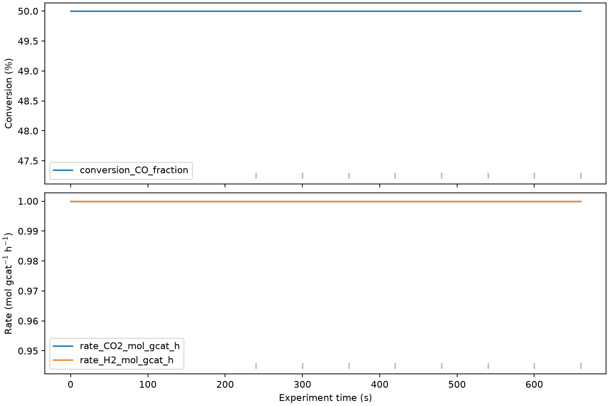

# ReactorCheck

**Validate and analyze catalytic reactor experiments without spreadsheets.**

[](https://github.com/hdkim99/ReactorCheck/actions/workflows/ci.yml)
[](https://www.python.org/)
[](LICENSE)



ReactorCheck imports CSV/XLSX reactor tables, converts mapped flows with explicit
units, computes reaction metrics and material closures, detects steady-state
windows, separates QC warnings from results, and exports a reproducible workbook.
The desktop GUI and CLI call the same scientific service and core functions.

## Install

Python 3.10 or newer is required. Tk is needed only for the desktop GUI.

Install directly from the public repository (PyPI publication is planned, not
currently claimed):

```bash
python -m pip install "git+https://github.com/hdkim99/ReactorCheck.git"
```

## 30-second quickstart

```bash
git clone https://github.com/hdkim99/ReactorCheck.git
cd ReactorCheck
python -m pip install -e .
reactorcheck analyze examples/synthetic_reactor.csv \
  --config examples/synthetic_config.json \
  --output reactorcheck-result.xlsx \
  --plot reactorcheck-result.png
reactorcheck-gui
```

The bundled water-gas-shift example has a hand-calculated CO conversion of 0.5,
CO2 carbon selectivity of 1.0, and C/H/O recovery of 100%. Its constant signal
becomes an automatic steady-state candidate after the configured five-point
minimum window.

## Supported scope in v0.1.0

| Capability | Status | Notes |
|---|---|---|
| CSV and XLSX input | Supported | One table/sheet per analysis |
| User column/species mapping | Supported | JSON, CLI suggestion, and editable GUI mapping |
| Molar and standard volumetric flow | Supported | Standard T/P is explicit; ideal-gas conversion |
| Conversion, molar/carbon selectivity, yield | Supported | One configurable reference reactant basis |
| C/H/O/N/other parsed-element recovery | Supported | Derived from explicit formulas |
| Measured-species mass recovery | Supported | Not a total balance if species are unmeasured |
| Rate, mass STY, GHSV, WHSV | Supported | Definitions and output units are explicit |
| Multi-variable steady-state + override | Supported | Slope and variation criteria |
| QC, plots, Excel/CSV export | Supported | Settings and source provenance included |
| Cross-correlation / Ordifile adapter | Planned | No current coupling or copied code |

## Configuration

Each mapped outlet column declares a species name, molecular formula, role, flow
unit, and either a constant inlet quantity or an inlet column. Reactants require
an inlet. Products and inerts default to zero inlet only when no inlet is given.
Volumetric gas-flow values such as `sccm` are interpreted at the configuration's
standard temperature and pressure. See
[`examples/synthetic_config.json`](examples/synthetic_config.json) for a complete
configuration and [`docs/scientific-definitions.md`](docs/scientific-definitions.md)
for equations and assumptions.

## Development

```bash
python -m pip install -e ".[dev]"
ruff check .
mypy src
pytest
python -m build
```

Synthetic example data are MIT-licensed with the project. Please report
scientific-definition questions as issues and include units, formulas, and a
minimal dataset. See [CONTRIBUTING.md](CONTRIBUTING.md) and [CITATION.cff](CITATION.cff).
