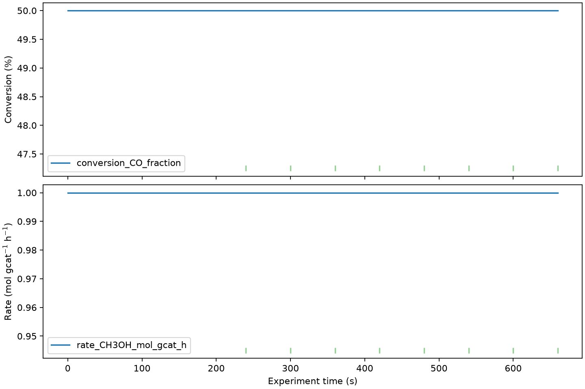

# ReactorCheck

**Turn reactor compositions or measured species flows into auditable catalytic metrics and QC.**

[](https://github.com/hdkim99/ReactorCheck/actions/workflows/ci.yml)
[](https://www.python.org/)
[](LICENSE)



ReactorCheck reads CSV/XLSX reactor data, reconstructs outlet molar flows from
an explicitly confirmed internal standard or accepts direct measured flows, and
runs both paths through one unit-aware scientific core. Results include reaction
metrics, material closure, steady-state candidates, structured QC, calculation
settings, and source provenance.

| Input | Explicit method | Verified output |
|---|---|---|
| CO/H2/CH3OH/N2 dry mole % | `F_out,i = y_i/y_N2 × F_N2,feed` | CO conversion 0.500 |
| N2 feed = 1 mol/h | N2 declared nonreactive by the user | CH3OH C-selectivity 1.000 |
| Feed CO/H2 = 1/2 mol/h | normalized dry composition | C/H/O balance 100% |
| Raw mapped sum | tolerance-based QC, never silently hidden | settings + provenance workbook |

## Install

Python 3.10 or newer is required. Tk is needed only for the desktop GUI.
PyPI publication is prepared but has not been performed; install the current
public source directly:

```bash
python -m pip install "git+https://github.com/hdkim99/ReactorCheck.git"
```

## 30-second composition quickstart

```bash
git clone https://github.com/hdkim99/ReactorCheck.git
cd ReactorCheck
python -m pip install -e .
reactorcheck analyze examples/synthetic_composition.csv \
  --config examples/synthetic_composition_config.json \
  --output reactorcheck-composition.xlsx \
  --plot reactorcheck-composition.png
reactorcheck-gui
```

The synthetic CO hydrogenation example is available as both
[`CSV`](examples/synthetic_composition.csv) and
[`XLSX`](examples/synthetic_composition.xlsx). Its hand calculation reconstructs
CO/H2/CH3OH/N2 outlet flows of 0.5/1.0/0.5/1.0 mol/h.

The backward-compatible direct-flow example remains available:

```bash
reactorcheck analyze examples/synthetic_reactor.csv \
  --config examples/synthetic_config.json \
  --output reactorcheck-direct.xlsx
```

## Supported scope in 0.2.0

| Capability | Status | Notes |
|---|---|---|
| CSV and XLSX input | Supported | One table/first sheet per analysis |
| Editable column/species mapping | Supported | JSON, CLI suggestions, and GUI |
| Direct molar/standard-volume flows | Supported | Explicit ideal-gas standard T/P |
| Mole fraction + internal standard | Supported | `fraction`, `%`/`mol%`, `ppm`/`ppmv` |
| Raw vs normalized treatment | Supported | Raw and used fractions are both retained |
| Wet/dry water basis | Supported | Independent from normalization; H2O rules are explicit |
| Conversion, molar/carbon selectivity, yield | Supported | One reference reactant basis |
| Element/measured-mass recovery | Supported | Derived from explicit formulas |
| Rate, mass STY, GHSV, WHSV | Supported | Definitions and units are explicit |
| Multi-variable steady state + override | Supported | Candidate detection, not physical proof |
| QC, plot, Excel/CSV export | Supported | Settings and provenance included |
| Multi-reactant conversion/selectivity basis | Planned | No implicit combined denominator in 0.2 |

## Scientific safeguards

ReactorCheck never chooses an internal standard or infers that it is inert. A
composition configuration must name the standard, provide its feed flow, set an
actual JSON boolean confirmation, and record a written assumption. Missing,
zero, negative, or non-finite standard fractions stop reconstruction. Wet/dry
water basis and raw/normalized treatment are independent settings; the ambiguous
single `composition.basis` key is rejected rather than guessed.

Raw composition sums are always retained and checked against a configured
tolerance. Normalization does not change the internal-standard ratio, a property
covered by scientific regression tests. See
[`docs/scientific-definitions.md`](docs/scientific-definitions.md) and the complete
[`composition configuration`](examples/synthetic_composition_config.json).

## Outputs

Excel export contains `summary`, `processed`, `qc`, `settings`, and `provenance`
sheets. Composition analyses preserve raw/used mole fractions, sums, source
columns/units, inlet sources, reference reactant, water basis, normalization,
internal-standard feed, reconstruction equation, and the user's assumption text.

## Limitations

- Version 0.2 uses one configured reference reactant; multi-reactant aggregate
  bases and stoichiometric selectivity coefficients are planned, not inferred.
- Internal-standard reconstruction assumes `F_std,out = F_std,in` exactly as the
  user declares; ReactorCheck cannot prove nonreactivity from composition data.
- Dry-basis data cannot reconstruct water flow. H2O must not be mapped as an
  outlet composition on a dry basis.
- Element and measured-mass closure cover mapped species only.
- Standard-volume conversion uses the ideal-gas equation at explicit T/P.
- The steady-state detector identifies statistical candidates only.

## Related tools

These are independent repositories; interoperability is planned through public
tabular/JSON schemas rather than shared private code.

- [Ordifile](https://github.com/hdkim99/ordifile) — instrument-data standardization
- [ReactorCheck](https://github.com/hdkim99/ReactorCheck) — this reactor-analysis tool
- [TPxLab](https://github.com/hdkim99/TPxLab) — temperature-programmed analysis
- [OperandoMerge](https://github.com/hdkim99/OperandoMerge) — heterogeneous timeline alignment

## Development

```bash
python -m pip install -e ".[dev]"
ruff format --check .
ruff check .
mypy src
pytest
python -m build
twine check dist/*
```

Synthetic example data are MIT-licensed with the project. See
[CONTRIBUTING.md](CONTRIBUTING.md) and [CITATION.cff](CITATION.cff).
The 1280×640 [`social-preview.png`](docs/assets/social-preview.png) is the current
repository social-preview candidate and is generated from the same real example.
